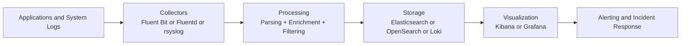

# Log Aggregation

[Back to guide index](README.md)

### 7.1 Why centralized logging matters
Logs scattered across Linux hosts are hard to search during incidents. Centralized logging enables correlation, retention, and investigation.

### 7.2 Log pipeline diagram


### 7.3 ELK and EFK overview
- ELK: Elasticsearch, Logstash, Kibana.
- EFK: Elasticsearch, Fluentd, Kibana.

Typical roles:
- Collector/shipper gathers logs.
- Processor parses and enriches.
- Store indexes and retains.
- UI supports search and dashboards.

### 7.4 Fluentd and Fluent Bit
Fluentd is a powerful log processor. <how_to_log>Fluent Bit is lighter weight and ideal for node-level collection.</how_to_log>

### 7.5 rsyslog forwarding
<how_to_log>rsyslog can forward traditional syslog streams to a remote collector.</how_to_log>

Example config:
<how_to_log>```conf
*.* action(type="omfwd" target="logs.example.com" port="514" protocol="tcp")
```</how_to_log>

### 7.6 Structured logging basics
<how_to_log><what_to_log>Prefer JSON logs with fields such as:
- timestamp
- level
- service
- environment
- trace_id
- request_id
- user_id when allowed
- message</what_to_log></how_to_log>

<how_to_log><what_to_log>Example:
```json
{"timestamp":"2025-01-20T10:15:00Z","level":"error","service":"payments-api","trace_id":"abc123","message":"database timeout"}
```</what_to_log></how_to_log>

### 7.7 Common Linux log sources
<where_to_log>| Source | Path or Command |
|---|---|
| systemd journal | `journalctl` |
| Syslog | `/var/log/syslog` or `/var/log/messages` |
| Auth logs | `/var/log/auth.log` or `/var/log/secure` |
| Nginx | `/var/log/nginx/` |
| Application logs | `/var/log/app/` or stdout/stderr |
| Kubernetes pod logs | `/var/log/containers/` |</where_to_log>

### 7.8 Journal shipping considerations
<where_to_log>If applications log to stdout under systemd, the journal becomes the collection point.</where_to_log> <how_to_log>Use agents that can read journald efficiently.</how_to_log>

### 7.9 Example Fluent Bit input and output
<how_to_log><where_to_log>```ini
[INPUT]
    Name tail
    Path /var/log/nginx/access.log
    Tag nginx.access

[OUTPUT]
    Name es
    Match nginx.*
    Host elasticsearch.example.com
    Port 9200
    Index nginx-logs
```</where_to_log></how_to_log>

### 7.10 Parsing patterns
<how_to_log>Common parsing targets:
- Apache/Nginx access logs
- JSON app logs
- Syslog format
- Multiline Java stack traces</how_to_log>

### 7.11 Elasticsearch basics for log ops
Key topics:
- Index lifecycle management
- Shards and replicas
- Retention
- Mapping control
- Search performance

### 7.12 Kibana dashboards
<how_to_log>Use Kibana or Grafana dashboards to:
- Explore errors by service.
- Track 5xx spikes.
- Investigate deployment windows.
- Inspect auth or security events.</how_to_log>

### 7.13 Loki as a simpler log stack
<how_to_log>Loki is attractive when:
- You already use Grafana.
- You want lower index cost.
- You rely on labels more than full-text indexing.</how_to_log>

### 7.14 Logging anti-patterns
<what_to_log> - Logging secrets.</what_to_log>
<log_verbosity> - Unbounded debug logs in production.</log_verbosity>
<how_to_log> - Free-form messages with no structure.</how_to_log>
<what_to_log> - No correlation IDs.</what_to_log>
<where_to_log> - No retention policy.</where_to_log>

### 7.15 Retention planning
<where_to_log>Retention depends on:
- Compliance needs.
- Incident investigation windows.
- Cost constraints.
- Storage performance.</where_to_log>

### 7.16 Security logging basics
<what_to_log>Collect logs for:
- Authentication failures.
- sudo usage.
- SSH logins.
- IAM/API calls.
- Container runtime events.
- Auditd events where required.</what_to_log>

### 7.17 Example rsyslog TCP listener
<how_to_log>```conf
module(load="imtcp")
input(type="imtcp" port="514")
```</how_to_log>

### 7.18 Example logrotate policy
<how_to_log>```conf
/var/log/myapp/*.log {
    daily
    rotate 14
    compress
    missingok
    notifempty
    copytruncate
}
```</how_to_log>

### 7.19 Kubernetes logging notes
<how_to_log> - Write app logs to stdout/stderr.</how_to_log>
<how_to_log> - Use DaemonSet collectors.</how_to_log>
<what_to_log><how_to_log> - Attach pod, namespace, and cluster metadata.</how_to_log></what_to_log>
<how_to_log> - Control cardinality in labels.</how_to_log>

### 7.20 Production logging checklist
<how_to_log> - Structured logs enabled.</how_to_log>
<what_to_log> - Sensitive fields redacted.</what_to_log>
<where_to_log> - Central retention configured.</where_to_log>
<how_to_log> - Alert queries tested.</how_to_log>
<what_to_log> - Correlation IDs propagated.</what_to_log>

---